# Chats page: groups are chats now

This change turns **Groups** into **Chats**. A group and its group chat are the same thing, so the separate
Groups page is gone. Everything now lives on one Chats page that works like a normal chat app. It also adds a
**💬 Chat** button to every friend in the friend list, which starts a chat directly.

It builds on the chat feature described in [chat.md](chat.md) (tables, backend, live updates). The test cases
in [section 5](#5-test-cases) are written so you can run them yourself, with two users side by side.

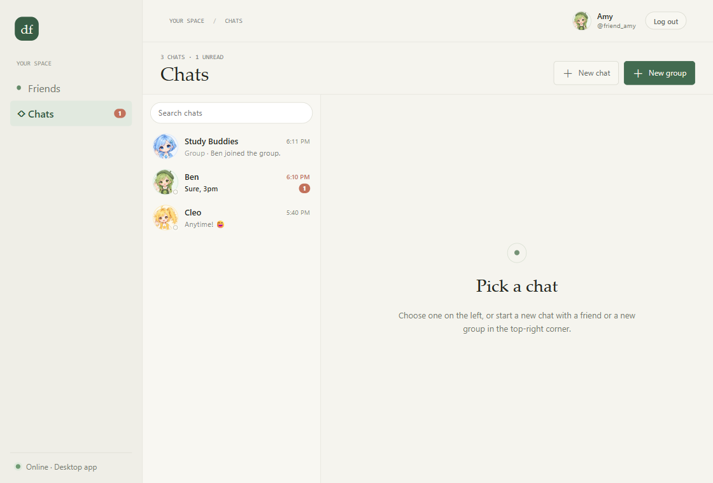

## Contents

1. [What changed](#1-what-changed)
2. [How the Chats page works](#2-how-the-chats-page-works)
3. [Code changes](#3-code-changes)
4. [Problems found while testing, and fixes](#4-problems-found-while-testing-and-fixes)
5. [Test cases](#5-test-cases)
6. [Automated tests](#6-automated-tests)
7. [Testing with two users on one computer](#7-testing-with-two-users-on-one-computer)
8. [Notes](#8-notes)

---

## 1. What changed

| Before | Now |
|---|---|
| Sidebar: Friends, **Groups**, plus GROUP CHATS and DIRECT MESSAGES lists | Sidebar: **Friends** and **Chats** only. The Chats badge counts unread messages plus group invitations |
| A **Groups page** (cards with members, invite, link, leave) and separate group chats | **Groups are chats.** Each group's details are in its chat's **ⓘ Group info** panel |
| New group / Join with a link on the Groups page | **＋ New group** in the **top-right corner** of the Chats page, with tabs *Create* and *Join with a link* |
| Direct chats started from a "Message" button in the friend list | **💬 Chat** next to every friend, plus **＋ New chat** (pick a friend) in the top-right corner |
| Chat lists split into groups and direct messages | **One list**, groups and friends mixed, newest first, with search, like a normal chat app |
| | **Only chats with a record are listed.** A friend you've never chatted with isn't in the list until the first message |

---

## 2. How the Chats page works

**The chat list (left)**

- Shows every chat that has a **chat record**: at least one message or note. Most recent first, groups and
  friends together.
- A friend you have never chatted with is **not** listed. Starting a chat with them (New chat or 💬 Chat)
  opens an empty chat ("No messages yet. Say hello 👋"). It shows in the list while it's open, and stays there
  once the first message is sent.
- Each row shows:
  - the avatar (with the friend's online dot);
  - the name and the time of the last message (time today, "Yesterday", the weekday this week, else the date);
  - a preview ("You: …", "Group · Ben: …");
  - the unread count, and 🔕 when muted.
- **Search** filters by chat name or username.
- **Invitations** to groups show at the top with **Join** / **Decline**. Joining opens the group's chat.

**The open chat (right)**: the same chat view as before: avatars, names, times, a date line at the first
message of each day, replies, reactions, edit, delete, typing and live updates. A group chat's header has
**ⓘ Group info**, which opens a side panel with:

- the group's avatar, name, description and member count; **Edit details** for the owner;
- **members** with online dots, the owner tag, and 💬 to chat with members who are your friends;
- **Invite a friend**, the **invite link** (Copy) and **Reset link** (owner);
- **Leave group**: the chat leaves your list. The last one out deletes the group and its chat.

**Top-right corner**

- **＋ New chat**: a searchable list of your friends with their status. Pick one to open your chat with them.
- **＋ New group**:
  - *Create*: name, description, a character as the group's avatar, and friends to invite. The new group's
    chat opens straight away.
  - *Join with a link*: paste an invite link to join the group and open its chat.

**Friend list (Friends page)**: every friend has a **💬 Chat** button that opens your chat with them.

| New chat | New group |
|---|---|
| 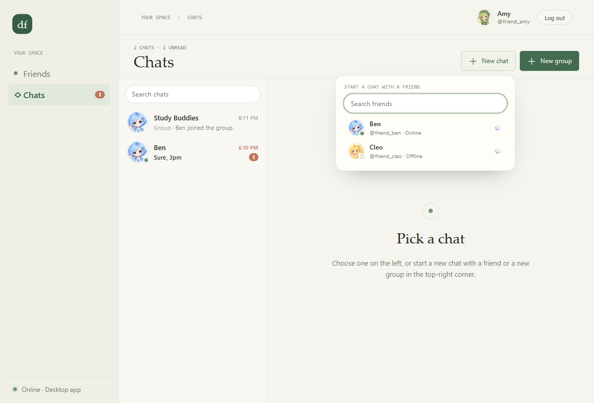 | 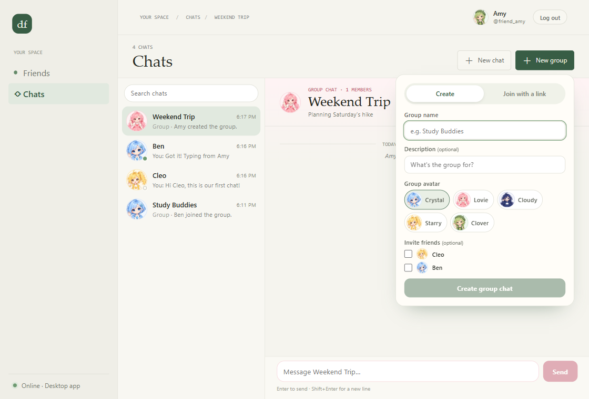 |

| Group info panel | A group invitation in the list |
|---|---|
| 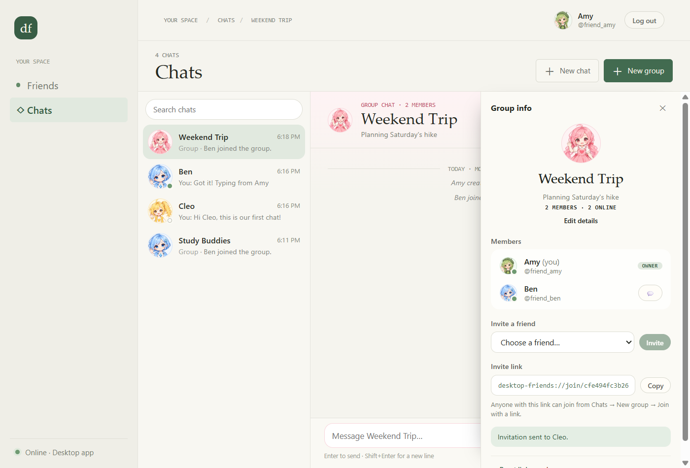 | 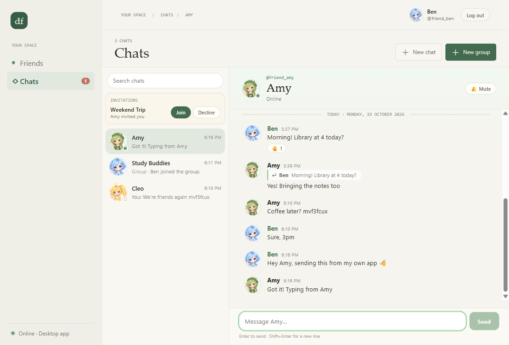 |

---

## 3. Code changes

All in `frontend/` except the backend fix in section 4. The database and API are unchanged.

**New** (`src/renderer/features/chat/`)

| File | What it is |
|---|---|
| `ChatsPage.tsx` | The page: header with New chat / New group (top-right), chat list, open chat, Group info panel. Reloads the list when opened |
| `ChatList.tsx` | The list column: search, invitations (Join / Decline), chats with a record |
| `NewChatMenus.tsx` | **New chat** (friend picker) and **New group** (Create / Join with a link) |
| `GroupInfoPanel.tsx` | The group's details: members, invite, invite link, reset link, edit details, leave (moved from the old Groups page) |
| `scripts/start-second.mjs` (+ `npm run start:second`) | Opens a second copy of the app with its own profile, for testing with two users |

**Changed**

| File | Change |
|---|---|
| `App.tsx` | Sidebar: Friends + Chats (badge = unread + invitations); routes to the Chats page |
| `ChatView.tsx` | "Group settings" became the **ⓘ Group info** toggle; "1 member" grammar |
| `chat.tsx` | `refreshConversations()` returns the list, so a newly created or joined group's chat can be opened at once |
| `FriendPresence.tsx` | The friend button is now **💬 Chat** |
| `shared/chat.ts` | `listedChats()` (chats with a record, open one, search) and `formatListTime()` |
| `styles.css` | Chats page, list, popovers, Group info panel; old Groups-page and sidebar-list styles removed |

**Removed**: `features/social/GroupsPage.tsx` (its parts moved into `NewChatMenus.tsx`, `ChatList.tsx` and
`GroupInfoPanel.tsx`) and `features/chat/ChatSidebar.tsx`.

---

## 4. Problems found while testing, and fixes

| Problem | Cause | Fix |
|---|---|---|
| A chat deleted elsewhere still showed in the list until the next refresh | The list was only reloaded by live events or every 60 s | The Chats page reloads the list each time it's opened |
| New group form: the "Invite friends" checkboxes were huge, names pushed to the far right | The form's input style (full width, 34 px tall) also hit the checkboxes | Checkboxes get their own small style |
| Header said "1 MEMBERS" | Fixed plural | "1 MEMBER" / "N MEMBERS" |
| **Backend: one 500 error** while Ben left a group | A "mark as read" for that chat arrived at the same moment. It read Ben's membership row, the leave deleted it, and the update then found no row | Marking read and muting are now single-statement updates that just change nothing if you've left (then answer 404). Sending a message marks read the same way. Any such race now returns **409 "That just changed"** instead of 500. Two new tests cover it |

---

## 5. Test cases

Users: **Amy** (`friend_amy`) and **Ben** (`friend_ben`) each in **their own copy of the app** (see section 7).
**Cleo** (`friend_cleo`) is the third user, acting through the API. All three are friends; the password for
all of them is `Friends#2026`. Everything ran against the hosted Supabase project.

| ID | What | Steps | Expected | Result |
|---|---|---|---|---|
| TC-01 | Navigation | Log in as Amy | Sidebar shows **Friends** and **Chats** only (no Groups); Chats badge counts unread + invitations | ✅ Pass |
| TC-02 | Chats page | Click **Chats** | Chat list on the left (groups and friends, newest first, time, preview, unread); "Pick a chat" on the right; **New chat** and **New group** top-right | ✅ Pass |
| TC-03 | Chat from friend list | As Ben: Friends → open the friend list → **💬 Chat** next to Amy | Ben's chat with Amy opens on the Chats page | ✅ Pass |
| TC-04 | No record → not listed | Use a friend you've never chatted with (Cleo). Open Chats. Then **New chat** → Cleo, and send a first message | Cleo isn't in the list at first. New chat opens an empty chat ("Say hello"). After the first message, Cleo is in the list with "You: …" | ✅ Pass |
| TC-05 | Direct message, live | Ben sends Amy a message | In Amy's app Ben jumps to the top with an unread count; the Chats badge goes up; no reload needed | ✅ Pass |
| TC-06 | Read + typing + reply | Amy opens Ben's chat and types a reply | Amy's unread clears; Ben's app shows "Amy is typing…" then her message, live | ✅ Pass |
| TC-07 | New group + invitation | Amy: **New group** → *Create*: "Weekend Trip", a description, Lovie avatar, invite Ben → *Create group chat*. Ben: **Join** on the invitation | Amy's new chat opens with "Amy created the group." Ben sees the invitation live at the top of his list (badge 1); **Join** opens the chat with "Ben joined the group." | ✅ Pass |
| TC-08 | Group chat, 3 users | Amy and Ben write in their apps; Cleo writes through the API | All messages appear in both apps, in order, with avatar, name and time | ✅ Pass |
| TC-09 | Group info + invite | Amy: **ⓘ Group info** → *Invite a friend* → Cleo → **Invite**; Cleo accepts | Panel shows members, owner tag, link, "Invitation sent to Cleo."; Cleo joins ("Cleo joined the group.", 3 members) | ✅ Pass |
| TC-10 | Search | Type "week", then "friend_cleo" in the list's search | Only *Weekend Trip*; then only *Cleo* | ✅ Pass |
| TC-11 | Leave + join with link | Ben: **Group info** → **Leave group** → *Leave*. Then **New group** → *Join with a link* with the group's link | The chat leaves Ben's list ("Pick a chat"); Amy sees "Ben left the group." live. Joining by link opens the chat again ("Ben joined the group.") | ✅ Pass |
| TC-12 | Edit details (owner) | Amy: **Group info** → **Edit details** → rename to "Saturday Hike" → Save | Ben's app shows the new name in the list and header, with "Amy renamed the group to "Saturday Hike"." | ✅ Pass |

Screens from the run:

| TC-04: an empty new chat | TC-03: 💬 Chat in Ben's friend list |
|---|---|
| 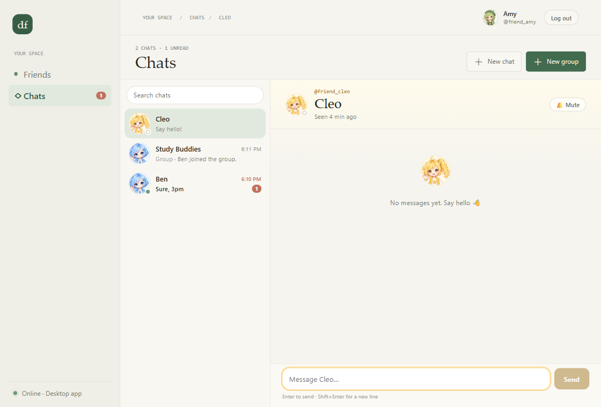 | 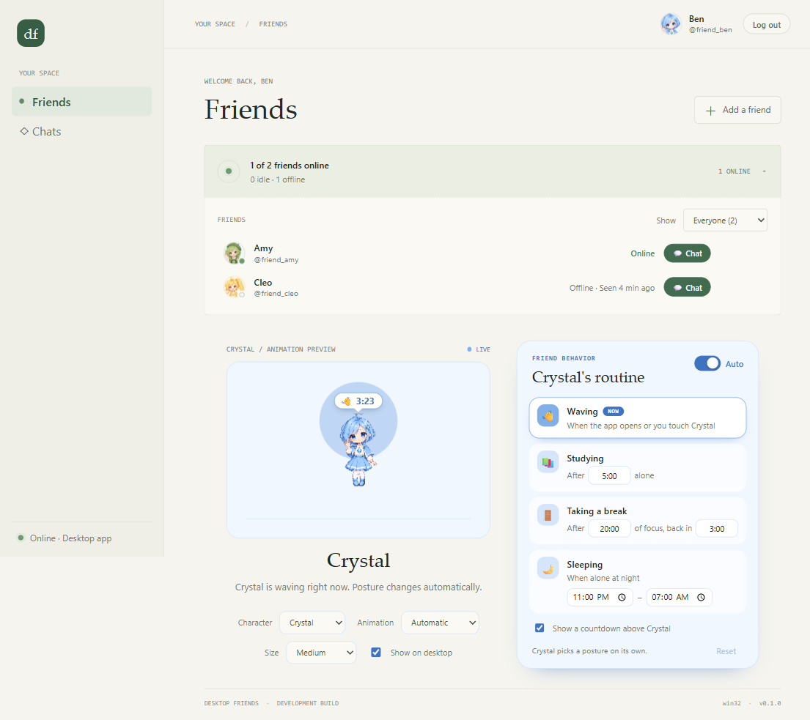 |

| TC-05: Ben's message arrives in Amy's app | TC-06: "Amy is typing…" in Ben's app |
|---|---|
| 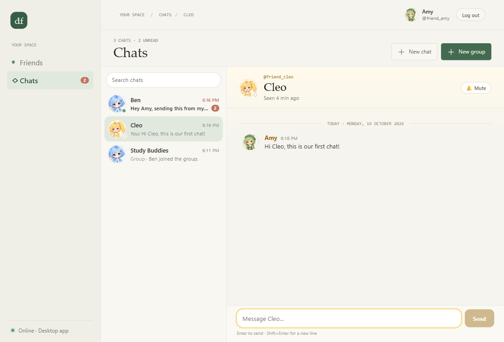 | 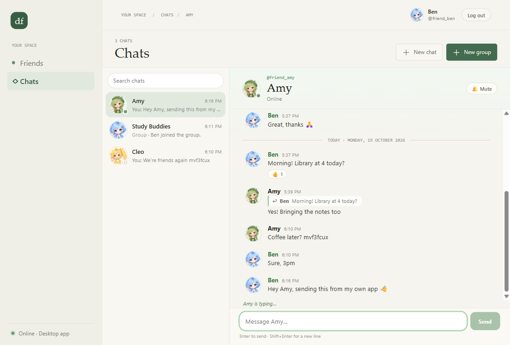 |

| TC-08: the group chat in Amy's app | TC-08: the same chat in Ben's app |
|---|---|
| 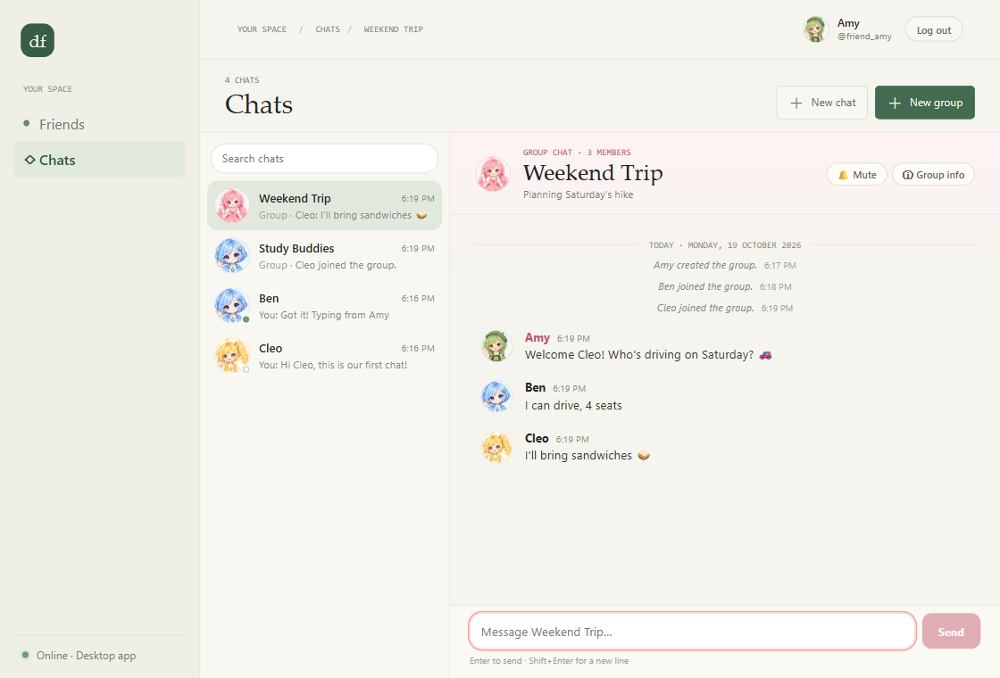 | 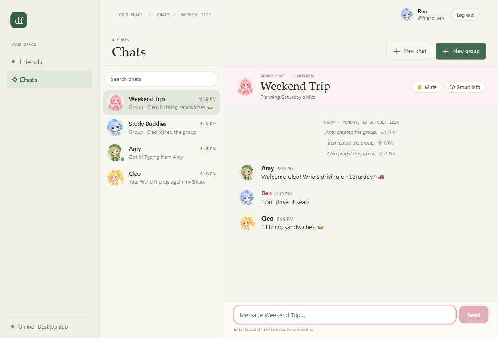 |

| TC-11: Ben left (his app) | TC-12: rename seen in Ben's app |
|---|---|
| 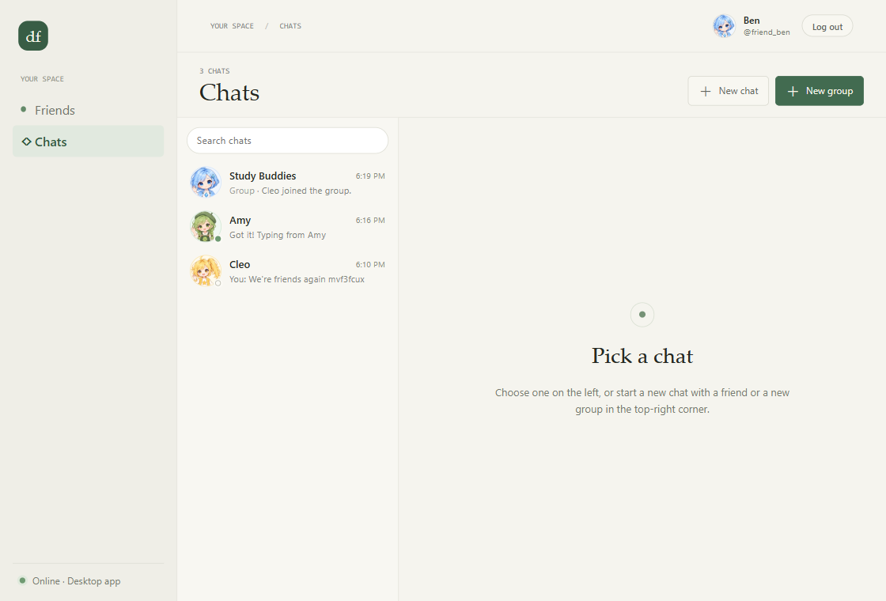 | 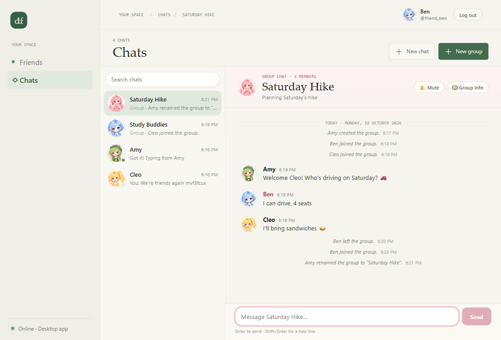 |

**Extra cases worth trying yourself:**
- Decline an invitation: it disappears and no chat is added.
- Mute a chat: its badge turns grey and stops counting in the sidebar.
- Unfriend someone: their chat stays readable, but the box says you can only message friends.
- The last member leaving: the group and its chat disappear for everyone.

---

## 6. Automated tests

| Suite | Command | Result |
|---|---|---|
| Backend (whole API, including chat; throwaway database per run) | `cd backend && ./mvnw test` | **70 / 70** (1 new: a race returns 409; plus read/mute after leaving returns 404) |
| App unit tests | `cd frontend && npm test` | **47 / 47** (2 new: chat-list rules and list times) |
| End to end on the **hosted** Supabase, Amy / Ben / Cleo | `cd frontend && npm run test:e2e` | **29 / 29** (chat 11, friends & groups 18), also re-run after the backend fix |

---

## 7. Testing with two users on one computer

The app only opens once per profile, so a second user needs a second profile:

```sh
cd backend && ./mvnw spring-boot:run                  # 1. the API
docker compose -f docker-compose.dev.yml up -d        # 2. nginx (from the project root)
cd frontend && npm run start                          # 3. first copy: log in as friend_amy
cd frontend && npm run start:second                   # 4. second copy, in another terminal: log in as friend_ben
```

The second copy keeps its sign-in and settings in `frontend/.profiles/second` (git-ignored). The first copy
must stay running: it serves the app to both. A third user can act through the API, or log in from another
computer.

---

## 8. Notes

- **Your avatar is your companion character on that computer.** When Ben logged in on the second copy, its
  companion (Crystal, the default) became his avatar. That's intended: picking a character in the app sets
  your avatar.
- **Rejoining a group shows its whole history**, including messages sent while you were away.
- **Latency:** opening a newly joined group takes a second or two, because each request goes to the hosted
  database in Tokyo; the chat list takes about 0.6 s.
- **Test data:** the test accounts still have their demo chats. The end-to-end run reset their groups to the
  demo state: Amy's "Study Buddies" with Ben, and Cleo invited.
